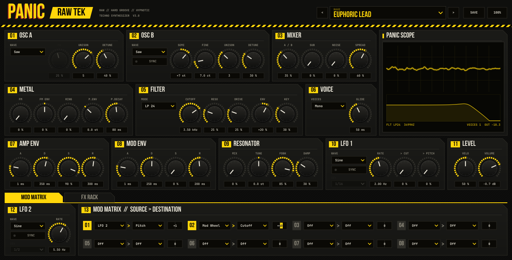
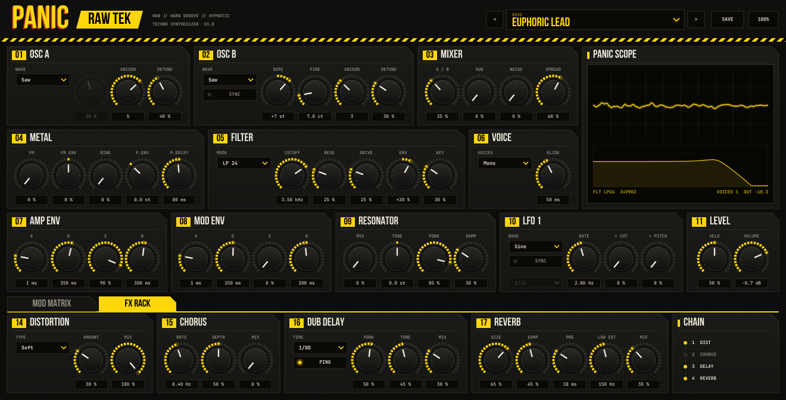

# PANIC RAW TEK

Synth VST3 / AU para Ableton Live (Mac, Apple Silicon e Intel), hecho para **raw techno, hard groove y techno hipnótico**: stabs con delay dub, supersaws rave, bleeps FM, bajos rodantes, metales, toms y rumbles.




## Motor

| Sección | Qué hace |
|---|---|
| **01 OSC A / 02 OSC B** | Saw / Square / Pulse / Triangle (PolyBLEP). **Unison de hasta 7 voces por oscilador** con detune (supersaw) y spread estéreo. OSC B: semitonos, fino y **hard sync** |
| **03 MIXER** | Balance A/B, sub-oscilador, ruido estéreo, ancho estéreo del unison |
| **04 METAL** | FM (OSC B modula la fase de A), FM por envolvente, ring mod, pitch envelope (−24 a +48 st) |
| **05 FILTER** | Ladder zero-delay con saturación y auto-oscilación: LP24 / LP12 / BP / HP, drive, envolvente, key tracking. Estéreo |
| **06 VOICE** | Mono (legato + glide) o Poly de 8 voces |
| **07 AMP ENV / 08 MOD ENV** | ADSR de amplitud y de modulación (filtro, FM y matriz) |
| **09 RESONATOR** | Comb metálico afinado a la nota: cuerdas Karplus, tubos, campanas |
| **10 LFO 1 / 12 LFO 2** | Sine, Triangle, Square, S&H, Saw ↓, Saw ↑. Libres o sincronizados al tempo (4/1 a 1/32, tresillos, puntillos) |
| **13 MOD MATRIX** | 8 slots fuente → destino. Fuentes: LFO 1/2, Mod Env, Amp Env, Velocity, Note, Random (por nota), Mod Wheel, Aftertouch. Destinos: Cutoff, Reso, Pitch, Osc B Pitch, PW, Mix, FM, Ring, Unison Detune, Noise, Sub, Drive, Resonator Tune/Mix, Amp, Pan |
| **14–17 FX RACK** | Distorsión 4× oversampling (Soft / Hard / Fold / Crush) → Chorus → **Dub Delay** (sync, ping-pong, feedback saturado y filtrado) → **Reverb FDN** (size, damp, predelay, low cut) |
| **PANIC SCOPE** | Osciloscopio en vivo, curva real del filtro, voces activas y nivel de salida |

Botón **100%** arriba a la derecha: cambia el tamaño de la ventana (75 % – 130 %).

## Presets

**152 presets incluidos dentro del plugin** (9 de fábrica + 143 del pack), agrupados por categoría en el menú del display de presets y en la lista de presets del dispositivo en Ableton.

Las categorías **HARD GROOVE**, **GROOVE PERC** y **OLD SCHOOL** siguen la línea del "modern old school techno" y el hard groove actual (SHDW & Obscure Shape / Mutual Rytm, BCCO, Future.666, Überkikz): stabs cortos para loops, órganos y hoovers 90s, bleeps, y un kit completo de percusión sintetizada (congas, cowbell, ride, hats, clap, toms, rim, shaker).

| Categoría | Presets |
|---|---|
| **Hard Groove** (16) | Broom Stab, Dirty Chord Loop, Federation Stab, Hoover Hit, Hyperdrive Riff, Loop Tool Bleep, Mutual Dub, Obscure Arp, Organ Hit 93, Phaser Loop Stab, Rave Bleep 155, Shadow Pad, Siren Hit, Stomp Stab, Turbo Bleep, Warehouse Chord Mem |
| **Groove Perc** (16) | Bongo Snap, Closed Hat Tight, Cowbell 808, Floor Tom Rumble, HG Conga Hi, HG Conga Low, Noise Clap, Open Hat Groove, Ride Metal, Rim Click, Shaker Groove, Snare Raw, Tin Perc, Tom Roll FM, Tribal Tom, Wood Block |
| **Old School** (10) | Birmingham Stab, Bleep Hit 91, Chord Hit Rave 92, Detroit Strings 94, Formant Stab, Industrial Loop Hit, Mentasm Stab, Sequence 909, Surgeon Loop, Tunnel Siren |
| **Groove** (14) | Concrete Haze, Dark Organ, Dub Chord Deep, Fog Stab, Groove Stab Short, Groove Tom, Hypno Perc Loop, Hypno Stab, Mental Bleep, Ritual Bell, Sonar Ping, Spiral Pluck, Tunnel Chord, Warp Bleep |
| **Rave** (9) | Euphoric Lead, Hard Groove Bleep, Hard Groove Stab, Panic Alarm, Rave Chord 90s, Rave Hoover, Rave Organ Stab, Supersaw Rave, Trance Gate |
| **Metal** (12) | Anvil Hit, Chain Drag, Factory Clang, Gong Strike, Hammered Plate, Iron Resonator, Metal Pipe, Rusted Bell, Sheet Metal, Steel Rod, Sync Shrapnel, Tin Can Zap |
| **Pluck** (10) | Bone Pluck, Dub Pluck, Glass Shard, Hollow Pluck, Karplus Wire, Metal Pluck, Raw Pluck, Rubber Pluck, Steel String, Wire Snap |
| **Bass** (21) | Concrete Bass, Crushed Bass, Dist Rolling, Fold Bass, Grind Roll, Grinder Bass, Groove Bass Pluck, Hard Groove Bass, Iron Sub, Kick Bass Groove, Metal Bass, Offbeat Pulse Bass, Offbeat Sub, Old School Sub Stab, Pressure Bass, Reese Groove, Rolling Bass, Rumble Engine, Rumble Groove, Rumble Sub Bass, Warehouse Low |
| **Stab** (7) | Berlin Stab, Dub Chord Raw, Hammer Stab, Metal Stab, Rave Stab Raw, Rust Stab, Shard Chord |
| **Perc** (11) | Clank, Groove Tom Low, Industrial Rim, Kick Body, Metal Conga, Metal Tom, Raw Kick, Shaker Crush, Steel Hat, Tick Noise, Zap Perc |
| **Lead** (5) | Chrome Lead, Grind Lead, Ring Lead, Siren Raw, Sync Scream |
| **Drone** (4) | Furnace Drone, Machine Hum, Metal Wind, Rust Drone |
| **FX** (8) | Alarm Metal, Down Lifter, Impact Down, Laser Drop, Noise Sweep Up, Riser Groove Noise, Riser Metal, Siren Rise |

**SAVE** guarda tus sonidos en la categoría *User* (`~/Library/Audio/Presets/Panic Audio/Panic Raw Tek/User/`).
Tips de groove: Random → Cutoff en la matriz para que cada golpe sea distinto; Mod Wheel → Cutoff para tocar en vivo; Trance Gate usa LFO 1 (square, 1/16) → Amp.

---

## Instalación en Mac

Necesitás Xcode Command Line Tools y CMake (`brew install cmake`). Cerrá Ableton y en la Terminal:

```bash
cd ~/Downloads/PanicRawTek
chmod +x reinstalar_limpio.command
./reinstalar_limpio.command
```

Desinstala cualquier versión anterior (incluido el viejo *RawTek*), compila desde cero e instala. Al final muestra la versión instalada (**3.1.0**).

Después, en Ableton: **Settings → Plug-Ins →** mantené **Option (⌥)** y hacé click en **Rescan**. Lo encontrás en *Plug-Ins → Panic Audio → Panic Raw Tek*.

- `build_mac.sh`: compila e instala (sin desinstalar antes).
- `desinstalar.command`: borra todo (respalda tus presets *User* en el Escritorio).
- **Sin compilar:** subí la carpeta a un repo de GitHub; *Actions* genera `PanicRawTek-mac-universal.zip` con el plugin listo y un `instalar.command`.

## Estructura

```
Source/SynthEngine.h       Motor: osciladores + unison, filtro, envolventes, LFOs, matriz, resonador, distorsión
Source/Effects.h           Chorus, dub delay, reverb FDN
Source/PluginProcessor.*   Parámetros, presets, MIDI, cadena de FX
Source/PluginEditor.*      Interfaz
Resources/Fonts/           Bebas Neue y JetBrains Mono (SIL Open Font License, licencias incluidas)
Presets/                   Pack de presets (.rtkpreset), se embebe en el plugin al compilar
tools/make_presets.py      Generador del pack · tools/level_presets.py nivelación · tools/demo_*.py demos
Tests/                     Render offline (cmake -DPANIC_BUILD_TESTS=ON)
```

Hecho con [JUCE](https://juce.com) 8. JUCE es gratis para uso personal; si algún día lo vendés, revisá su licencia.
